<h1 align="center">
  <a href="https://mitchtech.github.io/agent-warcraft/">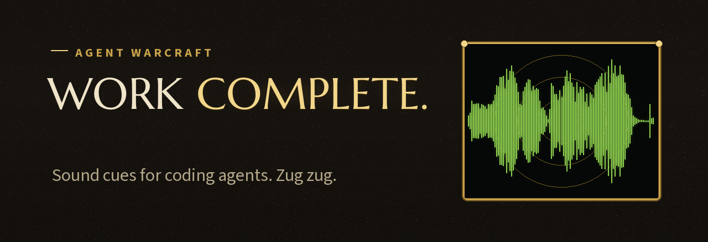</a>
</h1>

<p align="center">
  <a href="https://github.com/mitchtech/agent-warcraft/actions/workflows/check.yml"></a>
  <a href="https://github.com/mitchtech/agent-warcraft/releases/latest"></a>
  <a href="LICENSE"></a>
  <a href="pets/peon/LICENSE.txt"></a>
  <a href="audio/NOTICE.md"></a>
</p>

<p align="center"><b>Your coding agent says <i>Work complete!</i> when it finishes and <i>We need more gold!</i> when your usage runs out. Codex gets a Peon or a Peasant to keep it company.</b></p>

<p align="center">
  <a href="https://mitchtech.github.io/agent-warcraft/"><b>Hear every clip and meet the pets</b></a> ·
  <a href="#sounds">Event map</a> ·
  <a href="https://github.com/mitchtech/agent-warcraft/releases/latest/download/agent-warcraft-pet.zip">Download the Peon</a> ·
  <a href="https://github.com/mitchtech/agent-warcraft/releases/latest/download/agent-warcraft-peasant-pet.zip">Download the Peasant</a> ·
  <a href="#web-pets">Web pet atlases</a> ·
  <a href="https://github.com/mitchtech/agent-warcraft/releases">Releases</a> ·
  <a href="https://github.com/mitchtech/agent-navi">Agent Navi</a> ·
  <a href="https://github.com/mitchtech/agent-johnny5">Agent Johnny 5</a> ·
  <a href="https://github.com/mitchtech/agent-rocky">Agent Rocky</a> ·
  <a href="https://github.com/mitchtech/agent-starwars">Agent Star Wars</a> ·
  <a href="https://github.com/mitchtech/agent-starcraft">Agent StarCraft</a>
</p>

<table align="center">
  <tr>
    <td align="center">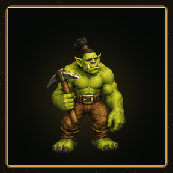<br><sub>Idle</sub></td>
    <td align="center">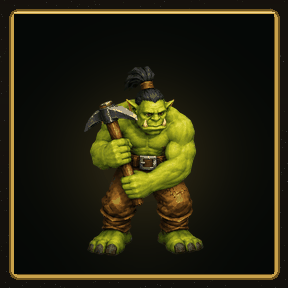<br><sub>Working</sub></td>
    <td align="center">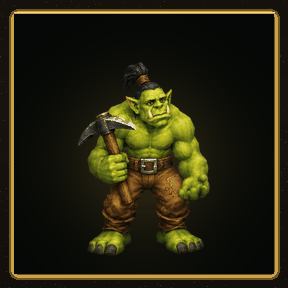<br><sub>Waiting</sub></td>
    <td align="center">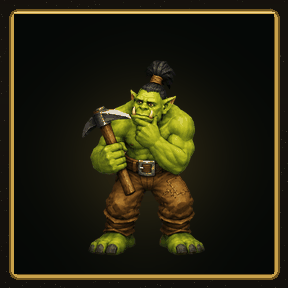<br><sub>Review</sub></td>
    <td align="center">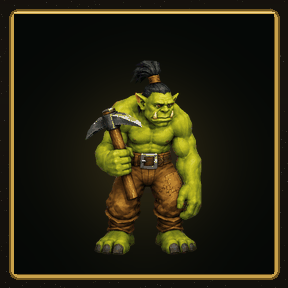<br><sub>Blocked</sub></td>
  </tr>
  <tr>
    <td align="center">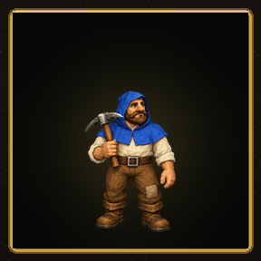<br><sub>Idle</sub></td>
    <td align="center">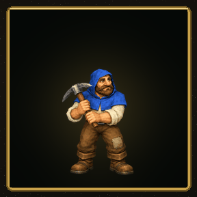<br><sub>Working</sub></td>
    <td align="center">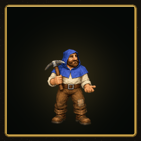<br><sub>Waiting</sub></td>
    <td align="center">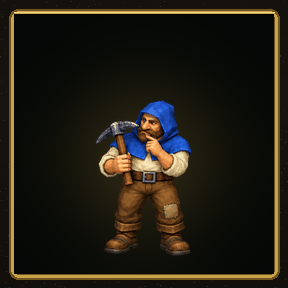<br><sub>Review</sub></td>
    <td align="center">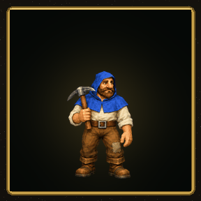<br><sub>Blocked</sub></td>
  </tr>
</table>

<table align="center">
  <tr>
    <td align="center">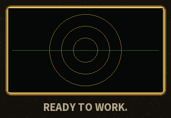<br><sub>Session start</sub></td>
    <td align="center">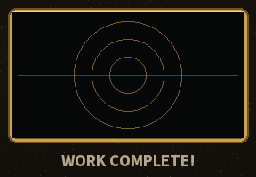<br><sub>Turn finished</sub></td>
    <td align="center">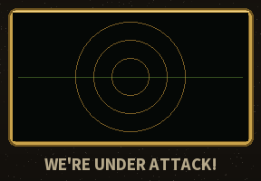<br><sub>Destructive command</sub></td>
    <td align="center">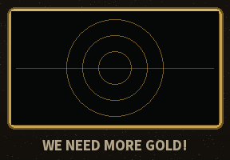<br><sub>Out of usage</sub></td>
    <td align="center">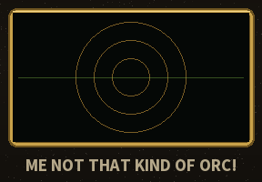<br><sub>Prompt spam</sub></td>
    <td align="center">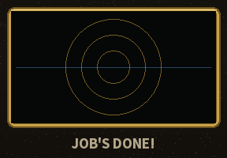<br><sub>Alliance</sub></td>
  </tr>
</table>

Warcraft peon sound notifications for coding agents and **two independent Codex
pets**. Native sound integrations for **Claude Code**, **Codex**, and **Gemini
CLI**, plus a small event interface for other agents and scripts. One shared
player supports macOS, Linux, and Windows. The orc Peon and human Peasant pets
use Codex's native animation and activity states.

Agent Warcraft plays 56 *Warcraft III* voice lines on agent events:

- "Ready to work." when a session starts and "Work work." when you send a prompt.
- "What you want?" when an approval is waiting, and "We're under attack!" when
  that approval is for `rm -rf`, a force push, or a dropped table.
- "Work complete!" when a turn finishes.
- "We need more gold!" when Claude Code stops on a rate limit or billing error.
- "Me busy, leave me alone!" when you send three prompts in ten seconds, exactly
  as a peon reacts to being clicked too often.

Pick the **Horde** (peon, grunt, and orc advisor; the default) or the
**Alliance** (peasant, footman, and knight: "Job's done!", "More gold is
required."), or mix both. It runs locally, sends no telemetry, and never
approves or blocks an agent's actions.

A sibling of [Agent Navi](https://github.com/mitchtech/agent-navi),
[Agent Johnny 5](https://github.com/mitchtech/agent-johnny5),
[Agent Rocky](https://github.com/mitchtech/agent-rocky),
[Agent Star Wars](https://github.com/mitchtech/agent-starwars), and
[Agent StarCraft](https://github.com/mitchtech/agent-starcraft), inspired by
[thephw/claude-meseeks](https://github.com/thephw/claude-meseeks). For a large
multi-game sound pack registry, see
[peon-ping](https://github.com/PeonPing/peon-ping).

## Choose your setup

| Choice | Install | Requirements |
|---|---|---|
| Sounds | [Agent plugin](#install) or standalone CLI | Node.js 22+ and local audio |
| Gold meter | [Status line command](#gold-meter-and-usage-alarms) | Claude Code status line |
| Codex pets | [Pet installer or manual ZIP](#codex-pets) | A host with compatible custom pets |

Installing the sound plugin never installs or selects a pet, and never changes
your status line.

## Sound requirements

- **Node.js 22 or newer**, with `node` on the agent's `PATH`.
- **macOS:** built-in `afplay`.
- **Linux:** `paplay`, `pw-play`, `aplay`, or `ffplay`, with a working local audio device.
- **Windows:** Windows PowerShell (`powershell.exe`), using `System.Media.SoundPlayer`.

No npm runtime dependencies, Bash, or `jq` are required. Windows hooks and audio
playback do not require Git Bash. A headless machine without an audio device
cannot play sounds on your laptop automatically.

## Install

### Claude Code

```bash
claude plugin marketplace add mitchtech/agent-warcraft
claude plugin install warcraft@agent-warcraft
```

Inside a Claude Code session, the same steps are `/plugin marketplace add` and
`/plugin install`.

### Codex

```bash
codex plugin marketplace add mitchtech/agent-warcraft
codex plugin add warcraft@agent-warcraft
```

Review and trust the installed hooks in Codex's hook settings before using them.
Installing or enabling the plugin does not automatically trust its hook commands.
Restart the agent after installation or updates.

### Gemini CLI

```bash
gemini extensions install https://github.com/mitchtech/agent-warcraft
```

Gemini selects a self-contained ZIP for your platform from GitHub Releases.
Review the extension's hook consent prompt and restart Gemini. For local
development:

```bash
npm run gemini
gemini extensions link ./dist/gemini
```

The repository root is for shared sources and discovery; Gemini's executable
hook file is included in the generated extension, not the source root. Install
published release assets rather than linking the repository root or a raw Git
branch. See [Gemini integration](docs/gemini.md).

### Running alongside the sibling plugins

Agent Navi, Agent Johnny 5, Agent Warcraft, Agent Rocky, Agent Star Wars, and
Agent StarCraft all respond to the same events. Enable one per host unless you
want a fairy, a robot, a peon, an Eridian, two droids, and an SCV talking over
each other. For example,
`claude plugin disable johnny5@agent-johnny5` for Claude Code, or
`enabled = false` under `[plugins."johnny5@agent-johnny5"]` in
`~/.codex/config.toml` for Codex.

### Local development

```bash
git clone https://github.com/mitchtech/agent-warcraft.git
cd agent-warcraft
node scripts/warcraft.mjs doctor
```

Use `claude plugin marketplace add /absolute/path/to/agent-warcraft` for Claude Code or
`codex plugin marketplace add /absolute/path/to/agent-warcraft` for Codex, followed by
the same plugin installation command above. `claude --plugin-dir /absolute/path/to/agent-warcraft`
tries it for one session without installing.

### Standalone command

For the `agent-warcraft` command outside an agent plugin:

```bash
npm install -g github:mitchtech/agent-warcraft
agent-warcraft doctor
agent-warcraft play approval_required --session my-session --tool Bash
agent-warcraft preview orc-work-complete
```

All commands also work as `node /path/to/agent-warcraft/scripts/warcraft.mjs ...`.
Standalone `play` and `preview` wait for the short clip; native hooks dispatch
playback to a detached worker so the agent can continue immediately.

## Codex pets

<p align="center"> </p>

Two native custom pets for Codex desktop and Codex CLI: the orc **Peon** and
the human **Peasant**. Each has nine animations and sixteen look directions.
Codex animates them from its own activity: they work while the agent works,
wait when it needs you, and slump when something fails. Pets and sounds are
independent; install either pet, both, or neither, with either faction's voice.

Without Node.js, from the latest release:

```bash
# Peon
curl -LO https://github.com/mitchtech/agent-warcraft/releases/latest/download/agent-warcraft-pet.zip
unzip agent-warcraft-pet.zip -d ~/.codex/pets
# Peasant
curl -LO https://github.com/mitchtech/agent-warcraft/releases/latest/download/agent-warcraft-peasant-pet.zip
unzip agent-warcraft-peasant-pet.zip -d ~/.codex/pets
```

With the standalone command, or from a checkout with `node scripts/warcraft.mjs`:

```bash
agent-warcraft pet install            # Peon
agent-warcraft pet install peasant    # Peasant
agent-warcraft doctor --pet peasant
```

Then refresh the Codex desktop pet picker, or enter `/pets Peon` or
`/pets Peasant` in a graphics-capable Codex CLI terminal. With `CODEX_HOME`
set, use `$CODEX_HOME/pets` instead. Installation leaves pet selection and
sound configuration unchanged; `--replace` keeps a backup of a different
existing pet. `pet status` and `pet uninstall` take the same optional name and
default to the Peon.

### Web pets

Creating a ChatGPT/Codex web pet instead? Upload the nine-row
[Peon atlas](https://github.com/mitchtech/agent-warcraft/releases/latest/download/agent-warcraft-pet-web.webp)
or [Peasant atlas](https://github.com/mitchtech/agent-warcraft/releases/latest/download/agent-warcraft-peasant-pet-web.webp)
and keep the CC BY 4.0 credit. See the [Peon guide](docs/pets.md) and the
[Peasant guide](docs/peasant.md) for compatibility, the web upload, backups,
and provenance.

## Sounds

Each event lists the Horde line first, then the Alliance line.

| Shared event | When | Horde / Alliance | Default |
|---|---|---|---|
| `session_started` | A session starts, resumes, or clears | "Ready to work." / "Ready to work." | On |
| `prompt_submitted` | You send a prompt | "I can do that." "Be happy to." "Work, work." "Okey dokey." / "Right-o." "Yes, me lord." "All right." "Off I go, then!" | On |
| `annoyed` | Your third prompt inside ten seconds | "Whaaat?" "Me busy. Leave me alone!" "No time for play." "Me not that kind of orc!" / "I didn't vote for you." "We found a witch!" "I'm being repressed!" "A horse kicked me once." | On |
| `approval_required` | A tool needs permission | "What you want?" "Yes?" / "Yes, milord?" | On |
| Approval for shell commands or file edits | | "Hmmm?" / "What?" | On |
| Approval for a destructive command | | "We're under attack!" "Our town is under attack!" / "Our forces are under attack!" "Our town is under siege." | On |
| `input_required` | The agent asks you a question | "Hmmm?" / "What?" | On where available |
| `ready_for_input` | Claude Code is idle and waiting | "Something need doing?" / "More work?" | On for Claude |
| `turn_completed` | The agent finishes responding | "Work complete!" / "Job's done!" | On |
| `out_of_gold` | Rate limit, billing error, account on hold, or budget spent | "We need more gold!" / "More gold is required." | On for Claude |
| `gold_low` | The gold meter crosses its threshold | "Our gold mine is running low." | On with the meter |
| `out_of_lumber` | A reply hits the output token limit | "We need more lumber." / "More lumber is required." | On for Claude |
| `error` | Claude Code stops on any other API error | "Our hero has been slain!" / "Our hero has fallen." | Off |
| `tool_failed` | A tool call fails | "Can't build there." / "I can't build there." | Off |
| `subagent_started` | A subagent starts work | "Zug zug." "Dabu." "Lok'tar." / "Aye, my lord." "On my way." "Of course." | Off |
| `context_compacting` | Context is about to be compacted | "Inventory is full." | Off |
| `session_ended` | A session ends | The peon's death grunt / a weary peasant groan | Off |
| Easter egg | | "For the Horde!" "My life for the Horde!" "Why not?" / "For Lordaeron!" "Ready for action." | 2% of session, prompt, ready, and completion cues |

`turn_completed` is on by default here, unlike the siblings: "Work complete" is
the line people install this for. `agent-warcraft preset attention` turns it off.

**Destructive commands** are recognized from the approval request's command:
`rm` with recursive and force flags, `git push --force` or `-f` (not
`--force-with-lease`), `git reset --hard`, `git clean -f`, `DROP TABLE`/`DATABASE`/`SCHEMA`,
`TRUNCATE TABLE`, `mkfs`, `dd of=`, `chmod -R 777`, `Remove-Item -Recurse -Force`,
and `rmdir /s`. The alarm is a louder cue, not a safety check: it never blocks,
approves, or logs the command. Only a yes/no flag leaves the hook process.

**Annoyed** lines replace the third and later prompts sent within ten seconds
in the same session, like clicking a WC3 unit repeatedly. Only timestamps are
stored, never prompt text. Turn them off with `agent-warcraft mute annoyed`.

**Easter eggs** never replace approval, question, error, or destructive-command
cues. Turn them off with `agent-warcraft mute easter-egg`.

Subagent completion is silent. Idle/input notifications and completion events
are distinct; event availability depends on the host. See
[compatibility](docs/compatibility.md).

## Factions

```bash
agent-warcraft faction horde      # orc peon and advisor (default)
agent-warcraft faction alliance   # human peasant, footman, and knight
agent-warcraft faction both       # mix every line
```

Every default cue has lines for both factions, so switching never silences an
event. Custom clip lists you write in the configuration are filtered the same
way; a list with no clips from the selected faction plays as written.

## Gold meter and usage alarms

Claude Code's `StopFailure` hook reports why a turn failed. Agent Warcraft maps
`rate_limit`, `billing_error`, and `account_on_hold` to `out_of_gold`,
`max_output_tokens` to `out_of_lumber`, and anything else to `error`. A
`quota_auto_resume_disabled` notification also plays `out_of_gold`.

For a warning before the gold runs out, add the meter to your status line. It
prints how much of your tightest limit is left and plays "Our gold mine is
running low." once per session when it crosses `gold.lowPercent` (80% used by
default), then "We need more gold!" at 100%. The status line runs outside the
plugin, so it needs the [standalone command](#standalone-command)
(`npm install -g github:mitchtech/agent-warcraft`):

```json
{ "statusLine": { "type": "command", "command": "agent-warcraft statusline" } }
```

```text
⛏ 18% gold (5h) low
```

The meter reads Claude Code's 5-hour, 7-day, and spend-limit percentages when
your plan reports them. Set `gold.budgetUsd` to also count a per-session dollar
budget against `cost.total_cost_usd`. To keep an existing status line, call
the meter from your own script; see [budget and status line](docs/budget.md).
Codex and Gemini have no equivalent hook; scripts there can run
`agent-warcraft play out_of_gold`.

## Sound controls

```bash
agent-warcraft status
agent-warcraft faction alliance
agent-warcraft mute prompt_submitted
agent-warcraft unmute prompt_submitted
agent-warcraft mute annoyed
agent-warcraft mute easter-egg
agent-warcraft unmute subagent_started
agent-warcraft mute all
agent-warcraft unmute all
agent-warcraft preset attention
agent-warcraft preset default
agent-warcraft list
agent-warcraft config --effective
```

Changes persist immediately and apply to the next hook, without restarting.
Global mute/unmute preserves individual event preferences.

- The **attention** preset keeps the approval, question, ready, and usage
  alarms (`out_of_gold`, `gold_low`, `out_of_lumber`). It turns off session,
  prompt, annoyed, completion, error, tool-failure, subagent, compaction, and
  session-end cues.
- The **default** preset restores event enablement. It leaves your custom
  clips, faction, audio directory, easter-egg setting, and global mute
  preference unchanged.

The bundled `warcraft-control` skill also handles requests such as "mute the
peon", "switch to Alliance", "turn off the annoyed lines", or "set up the gold
meter" inside supported agents. It uses the bundled CLI, so no global npm
installation is needed. `status --json` and `list --json` provide structured
output. Status shows when `AGENT_WARCRAFT_MUTE` overrides the saved global mute
setting.

## Configuration

Configuration stays outside plugin caches, so updates preserve your settings:

- macOS/Linux: `~/.config/agent-warcraft/config.json`, or `$XDG_CONFIG_HOME/agent-warcraft/config.json`.
- Windows: `%APPDATA%/agent-warcraft/config.json`.

Create the parent directory and save the settings you want to override:

```json
{
  "muted": false,
  "audioDir": "./audio",
  "cooldownMs": 1000,
  "faction": "both",
  "gold": { "budgetUsd": 20, "lowPercent": 75 },
  "easterEgg": { "chance": 0.05, "clips": ["orc-zug-zug"] },
  "events": {
    "session_started": { "clips": ["orc-ready"] },
    "approval_required": { "clips": ["orc-what-you-want"], "changeClips": ["orc-hmm"], "dangerClips": ["orc-town-under-attack"] },
    "subagent_started": { "enabled": true },
    "context_compacting": { "enabled": true }
  }
}
```

Omit `audioDir` to use bundled clips. Relative directories resolve from the
configuration file's directory. Custom audio directories must contain a
`<clip>.wav` for every name in `agent-warcraft list`; use 16-bit PCM WAV for
compatibility with all players. Copy the clips to your own directory before
replacing them. Installed plugin files can be overwritten by updates.

How clip settings work:

- An event's `clips` array selects one sound at random, after the faction
  filter. Use one entry for a fixed sound.
- `changeClips` applies to shell and file-change approvals.
- `dangerClips` applies to destructive-command approvals and takes priority.
- `easterEgg.chance` is a probability from 0 to 1.
- `gold.budgetUsd` is `null` (rate limits only) or a positive dollar amount.
  `gold.lowPercent` is between 0 and 100.
- Each event accepts `enabled: false` to mute it independently.

`agent-warcraft config` prints the complete default configuration without
writing anything.

| Environment variable | Effect |
|---|---|
| `AGENT_WARCRAFT_MUTE` | `1` mutes; `0` unmutes; overrides `muted` |
| `AGENT_WARCRAFT_CONFIG` | Explicit configuration file path |
| `AGENT_WARCRAFT_AUDIO_DIR` | Overrides the audio directory |
| `AGENT_WARCRAFT_STATE_DIR` | Overrides the local playback state directory |

Configure environment variables before starting the agent.

Repeats and overlaps are handled like this:

- Repeated events within `cooldownMs` for the same agent, session, and event are
  suppressed.
- A global playback lock drops overlapping clips across sessions.
- Claude's delayed permission notification is suppressed for at least 10 seconds
  after a matching approval alert. A permission notification without a preceding
  alert can still play.

State contains hashed event and session identifiers with timestamps or gold
levels only. Inactive records are cleaned up after a day, when another sound plays.

## Other agents

Call the shared interface when your agent emits an attention event:

```bash
agent-warcraft play session_started --session example
agent-warcraft play prompt_submitted --session example
agent-warcraft play approval_required --session example --tool Bash --command "rm -rf build"
agent-warcraft play turn_completed --session example
agent-warcraft play out_of_gold --session example
```

Every event honors its configuration toggle. Integration scripts should treat
playback failures as advisory. No tool-call or transcript polling is needed.

## Troubleshooting

```bash
node scripts/warcraft.mjs doctor
node scripts/warcraft.mjs preview orc-ready
```

`doctor` reports configuration, paths, player availability, clips, the faction,
enabled events, easter eggs, the gold meter, and the optional pet. `doctor
--pet` checks only the Peon (or `doctor --pet peasant`, the Peasant) and works without an audio player or valid sound
configuration. These commands operate without playing anything.

`preview` plays a clip even when muted and bypasses event cooldown, but still
respects overlap prevention. A busy player is reported explicitly instead of
silently skipping the preview. Neither command changes settings.

Native hooks exit successfully on malformed input, invalid configuration, missing
audio/player, or playback failure. They produce no prose or permission decisions.
Codex `Stop` and every Gemini hook emit only `{}` as neutral JSON required by
those hosts. The status-line meter always prints a line, falling back to a bare
`⛏`. Run diagnostics when sounds are missing, and check Node's availability and
hook trust settings.

SSH, containers, WSL, and cloud sessions play on the machine executing the hook.
An audio bridge must already exist if you expect those sounds on another machine.
GitHub marketplace installation is the distribution path; this hook plugin is
not submitted to OpenAI's public plugin directory.

## Development

```bash
npm run check
npm test
npm run test:package
python3 -m pip install -r requirements-dev.txt
python3 scripts/build-audio.py --check
python3 scripts/check-pet.py
python3 scripts/build-assets.py
python3 scripts/package-release.py
npm run site
```

Tests simulate players. They cover:

- host payloads and destructive-command detection
- faction filtering, the annoyed window, and usage alarms
- the gold meter and its once-per-session cues
- easter eggs, configuration, deduplication, and overlap
- failures, paths with spaces, and packaging

CI runs Node 22 and 24 on macOS, Linux, and Windows. See
[compatibility](docs/compatibility.md) and [release notes](CHANGELOG.md).

Python/Pillow are development tools for audio provenance, asset validation, and
previews, not runtime dependencies. `build-audio.py` rebuilds the clips from
[their recorded sources](audio/sources.json) with ffmpeg; `--check` verifies the
committed files offline. See [distribution maintenance](docs/distribution.md)
for releases and the site, and [contributor instructions](CONTRIBUTING.md) for
the project workflow.

## Credits and license

- Author: [Michael J. Mitchell / mitchtech](https://github.com/mitchtech).
- *Warcraft III: Reign of Chaos* (2002): Blizzard Entertainment. Warcraft is a trademark of Blizzard Entertainment.
- Clip sources: warcraft.wiki.gg file pages and The Sounds Resource *Warcraft III* archives.
- Peon and Peasant pet artwork: Michael J. Mitchell / mitchtech, made with Codex image generation, CC BY 4.0 ([Peon](pets/peon/LICENSE.txt), [Peasant](pets/peasant/LICENSE.txt)). No game sprites were extracted.
- Sibling projects: [Agent Navi](https://github.com/mitchtech/agent-navi), [Agent Johnny 5](https://github.com/mitchtech/agent-johnny5), [Agent Rocky](https://github.com/mitchtech/agent-rocky), [Agent Star Wars](https://github.com/mitchtech/agent-starwars), and [Agent StarCraft](https://github.com/mitchtech/agent-starcraft).
- Original plugin inspiration: [thephw/claude-meseeks](https://github.com/thephw/claude-meseeks). The peon-in-your-terminal idea owes a nod to [peon-ping](https://github.com/PeonPing/peon-ping).

Code and configuration: [MIT](LICENSE). Contributor rights in the pet artwork:
CC BY 4.0, with provenance and credit for the [Peon](pets/peon/NOTICE.md) and
the [Peasant](pets/peasant/NOTICE.md).
Bundled audio is excluded from both licenses; see the [audio rights notice](audio/NOTICE.md). Third-party character
rights and trademarks remain with their owners. This is a fan project, not
affiliated with or endorsed by Blizzard Entertainment.
